<!-- chrome: false -->

---

<!-- chrome: false -->

---

<!-- chrome: false -->

---

<!-- chrome: false -->

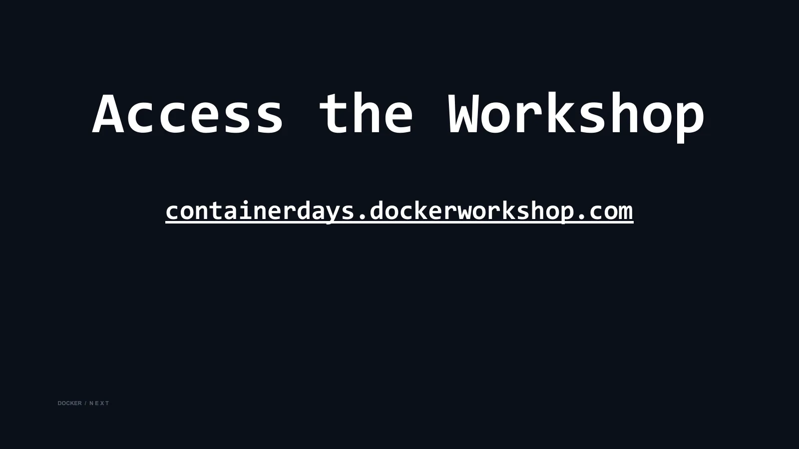

---

<!-- chrome: false -->

---

<!-- chrome: false -->

---

<!-- chrome: false -->

---

<!-- chrome: false -->

---

<!-- chrome: false -->

---

<!-- chrome: false -->

---

<!-- chrome: false -->

---

<!-- chrome: false -->

---

<!-- chrome: false -->

---

<!-- chrome: false -->

---

<!-- chrome: false -->

---

<!-- chrome: false -->

---

<!-- chrome: false -->

---

<!-- chrome: false -->

---

<!-- chrome: false -->

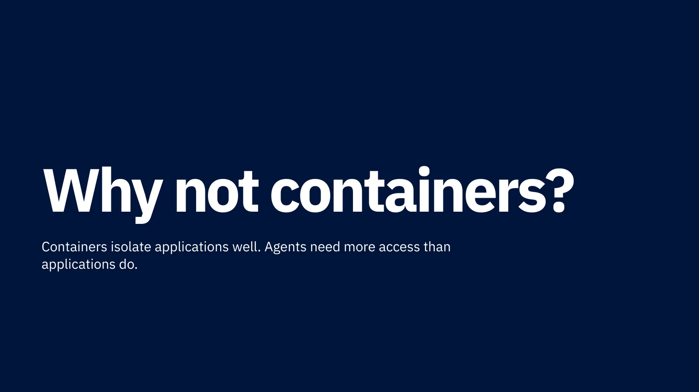

---

<!-- chrome: false -->

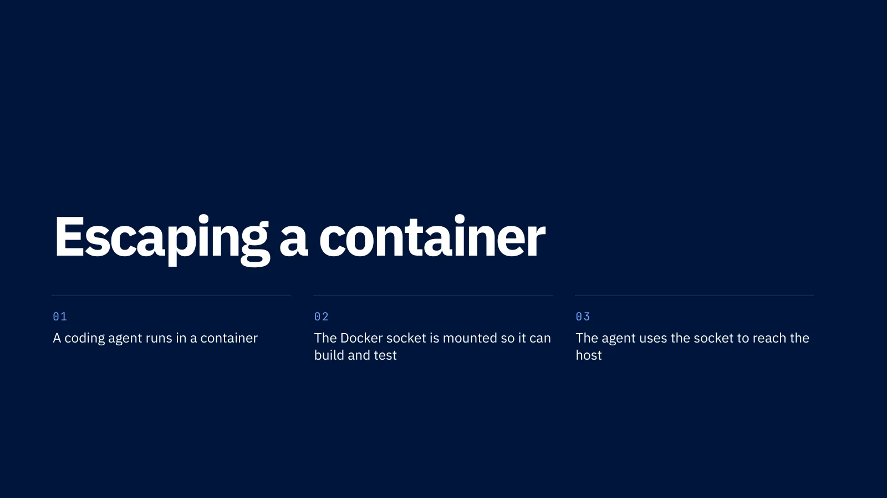

---

<!-- chrome: false -->

---

<!-- chrome: false -->

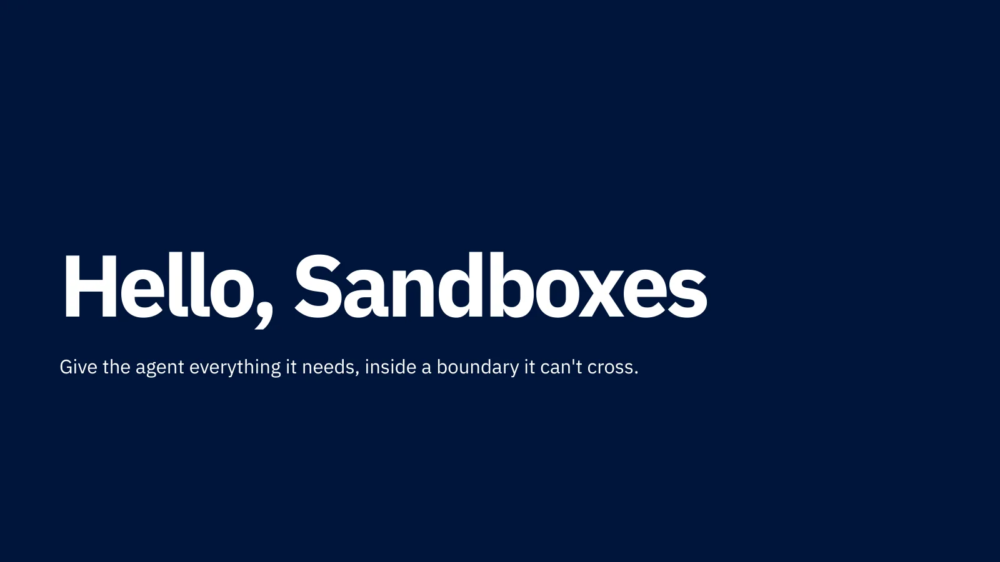

---

<!-- chrome: false -->

---

<!-- chrome: false -->

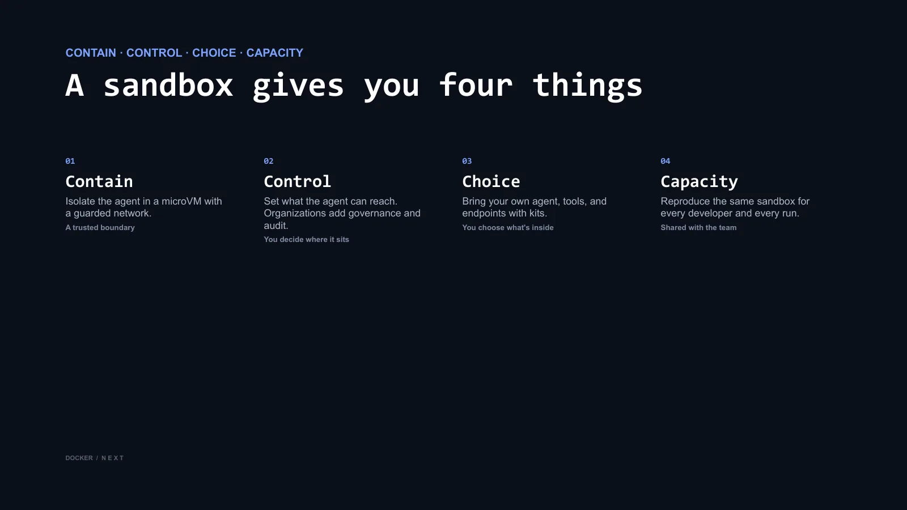

---

<!-- chrome: false -->

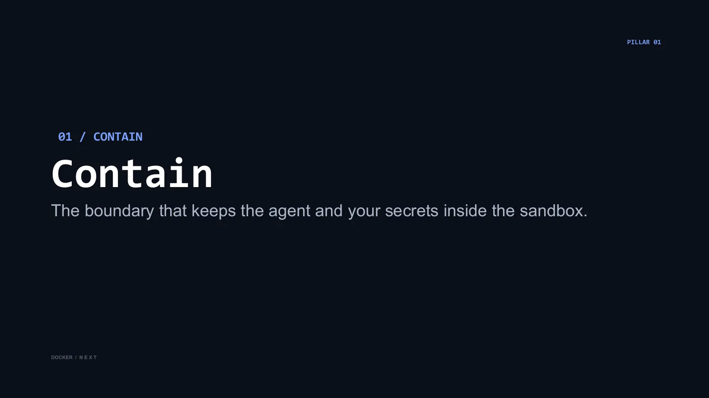

---

<!-- chrome: false -->

---

<!-- chrome: false -->

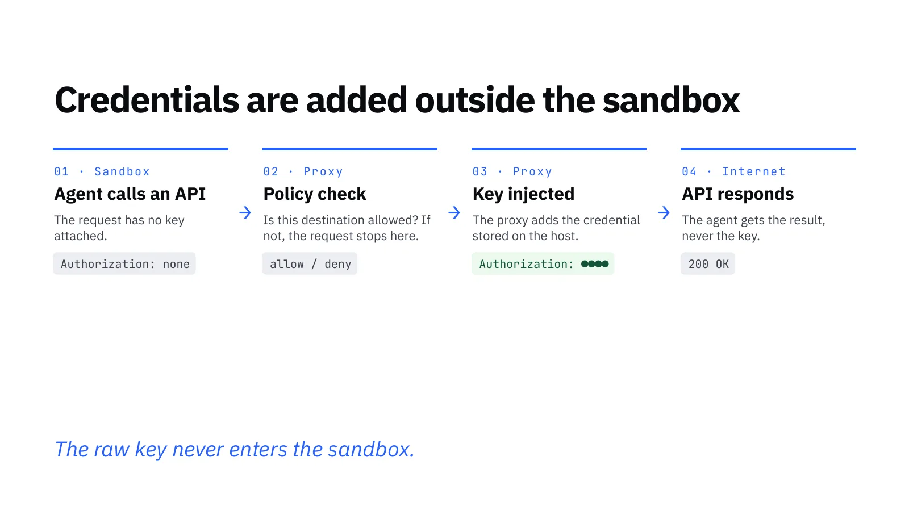

---

<!-- chrome: false -->

---

<!-- chrome: false -->

---

<!-- chrome: false -->

---

<!-- chrome: false -->

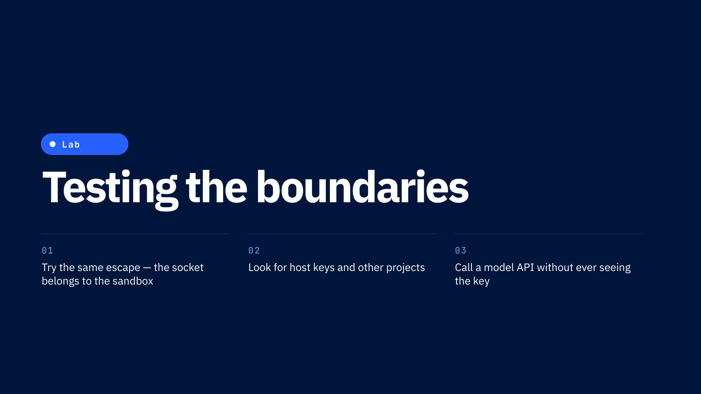

---

<!-- chrome: false -->

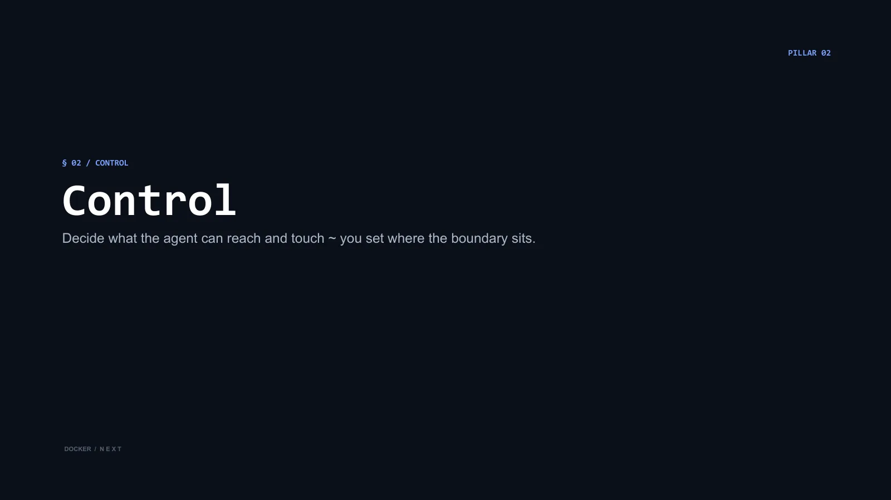

---

<!-- chrome: false -->

---

<!-- chrome: false -->

---

<!-- chrome: false -->

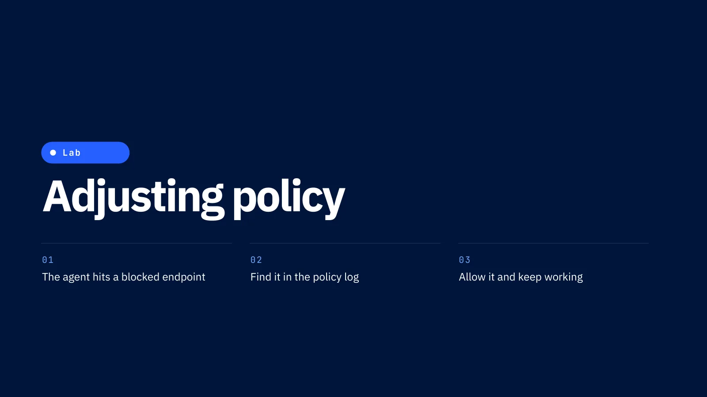

---

<!-- chrome: false -->

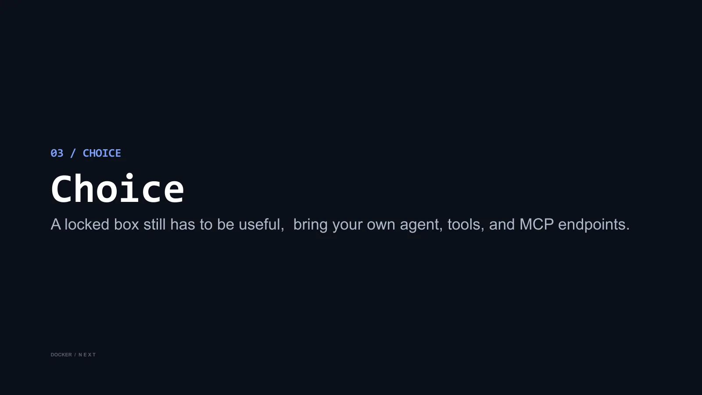

---

<!-- chrome: false -->

---

<!-- chrome: false -->

---

<!-- chrome: false -->

---

<!-- chrome: false -->

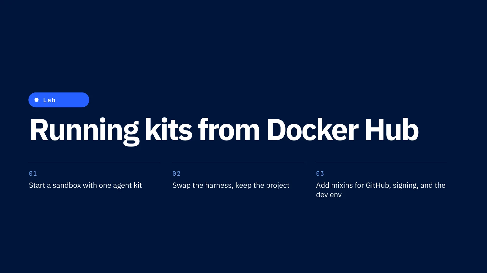

---

<!-- chrome: false -->

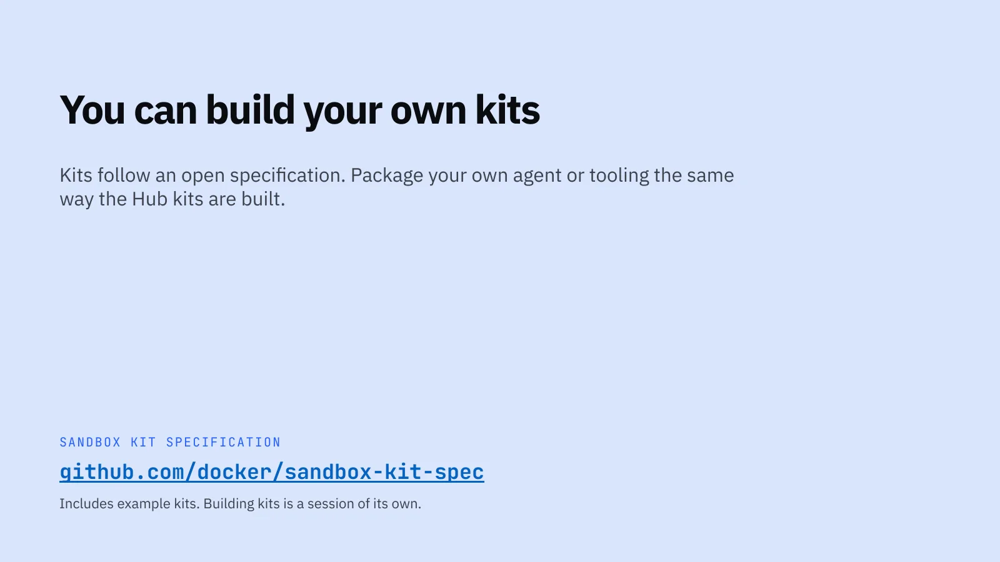

---

<!-- chrome: false -->

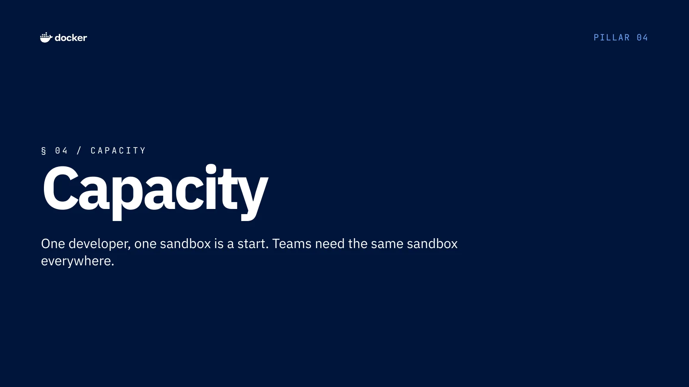

---

<!-- chrome: false -->

---

<!-- chrome: false -->

---

<!-- chrome: false -->

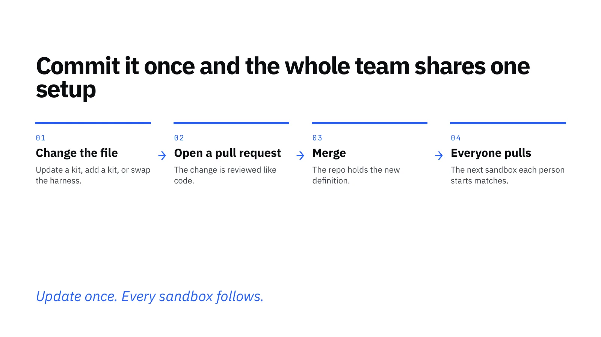

---

<!-- chrome: false -->

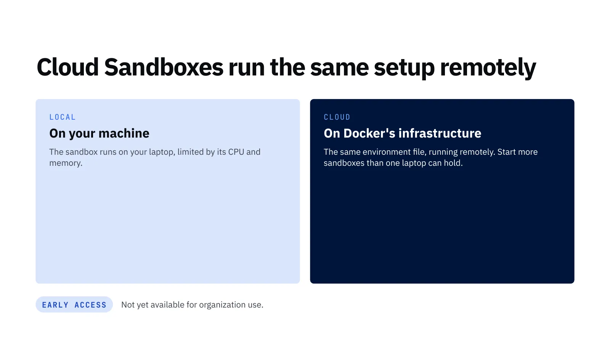

---

<!-- chrome: false -->

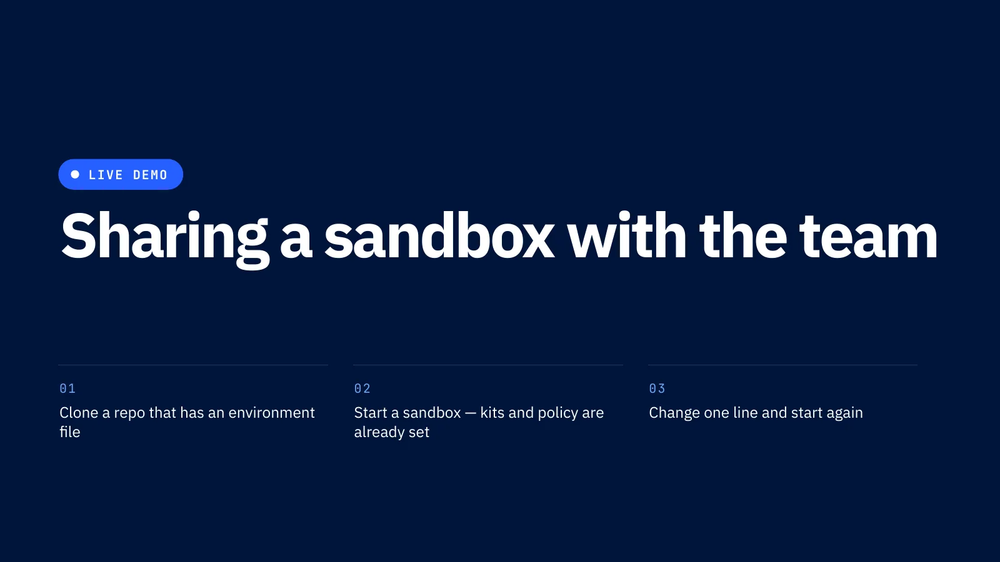

---

<!-- chrome: false -->

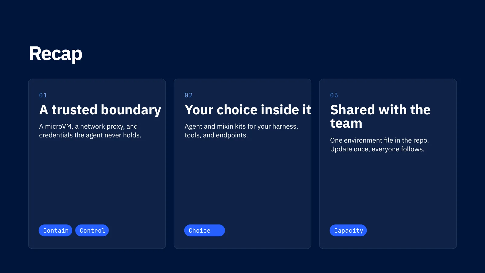
