<!-- chrome: false -->

CONTAINER DAYS SINGAPORE 2026

Run Fast Without Running Wild

AI Coding Agent Horror Stories and the microVM That Saves You

DOCKER&nbsp;&nbsp;/&nbsp;&nbsp;N&nbsp;E&nbsp;X&nbsp;T

---

<!-- chrome: false -->

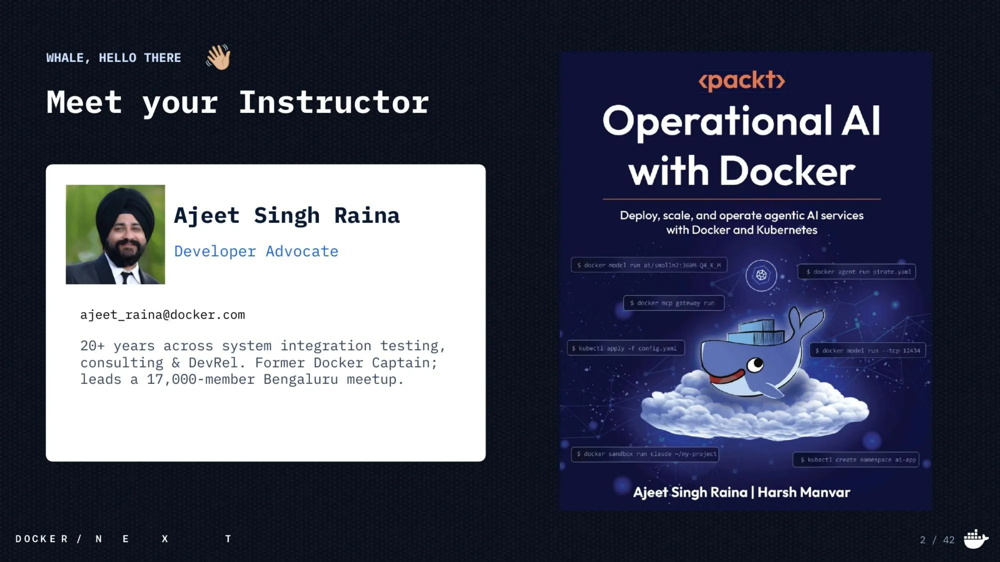

---

<!-- chrome: false -->

TODAY

Workshop &mdash; labs

Lab 1 &middot; Setup (2 min) &#10003;
<ul style="margin:12px 0 0;padding-left:20px;font:400 19px/1.6 ui-sans-serif,system-ui,sans-serif;color:#aeb8c9;"><li>Accessing the Workshop</li></ul>

Lab 3 &middot; Contain &amp; Control (45 min)
<ul style="margin:12px 0 0;padding-left:20px;font:400 19px/1.6 ui-sans-serif,system-ui,sans-serif;color:#aeb8c9;"><li>3 boundaries that surround every agent</li><li>Credentials added outside the sandbox</li><li>Testing the boundaries</li><li>What the agent can reach &mdash; adjusting policies</li></ul>

Lab 2 &middot; Autonomy requires guardrails (15&ndash;20 min)
<ul style="margin:12px 0 0;padding-left:20px;font:400 19px/1.6 ui-sans-serif,system-ui,sans-serif;color:#aeb8c9;"><li>Traditional vs agentic development workflow</li><li>Agents expand your attack surface</li><li>Coding Agent Horror Stories</li><li>Speed vs security &mdash; why not both?</li><li>Agent containerising the Product Catalog</li></ul>

Lab 4 &middot; Choice &amp; Capacity (30 min)
<ul style="margin:12px 0 0;padding-left:20px;font:400 19px/1.6 ui-sans-serif,system-ui,sans-serif;color:#aeb8c9;"><li>Kits define what runs inside the boundary</li><li>Running kits from Docker Hub</li><li>Build your own kits</li><li>sbxenv &mdash; describing the whole sandbox</li></ul>

DOCKER&nbsp;&nbsp;/&nbsp;&nbsp;N&nbsp;E&nbsp;X&nbsp;T

---

<!-- chrome: false -->

LAB 1 &middot; SETUP

Access the Workshop

containerdays.dockerworkshop.com &mdash; runs in your browser, nothing to install.

DOCKER&nbsp;&nbsp;/&nbsp;&nbsp;N&nbsp;E&nbsp;X&nbsp;T

---

<!-- chrome: false -->

THE SHIFT

AI agents are here &mdash; and doing real work

ENGINEERING

Read codebases, ship PRs

Agents read context, write code, and open pull requests without an engineer in the loop.

MARKETING

Pull CRM data, launch campaigns

Agents move from research to creative to send, end to end.

FINANCE

Reconcile reports, query live

Agents close the loop between ledger, dashboard, and decision.

DOCKER&nbsp;&nbsp;/&nbsp;&nbsp;N&nbsp;E&nbsp;X&nbsp;T

---

<!-- chrome: false -->

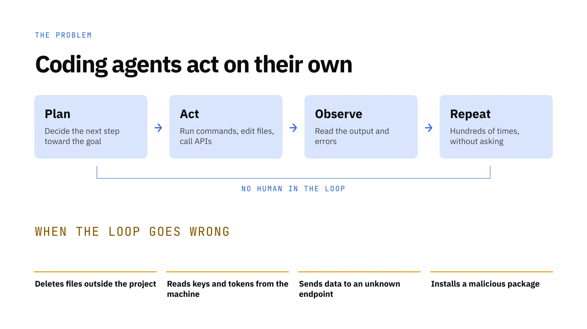

---

<!-- chrome: false -->

THE LETHAL TRIFECTA

Every useful agent is built on three things

RISK 01

Access to private data

Codebases, internal systems, credentials. The same data that makes it useful makes it dangerous.

RISK 02

Exposure to untrusted content

Web pages, emails, MCP responses. Any of it can carry instructions the agent will follow.

RISK 03

Ability to act externally

Send email, call APIs, touch the open internet. Once data leaves, it does not come back.

THE POINT

A useful agent has all three <b>by design.</b> You can't train it out, prompt it out, or policy-doc it out &mdash; the only fix is an enforcement layer at runtime.

DOCKER&nbsp;&nbsp;/&nbsp;&nbsp;N&nbsp;E&nbsp;X&nbsp;T

---

<!-- chrome: false -->

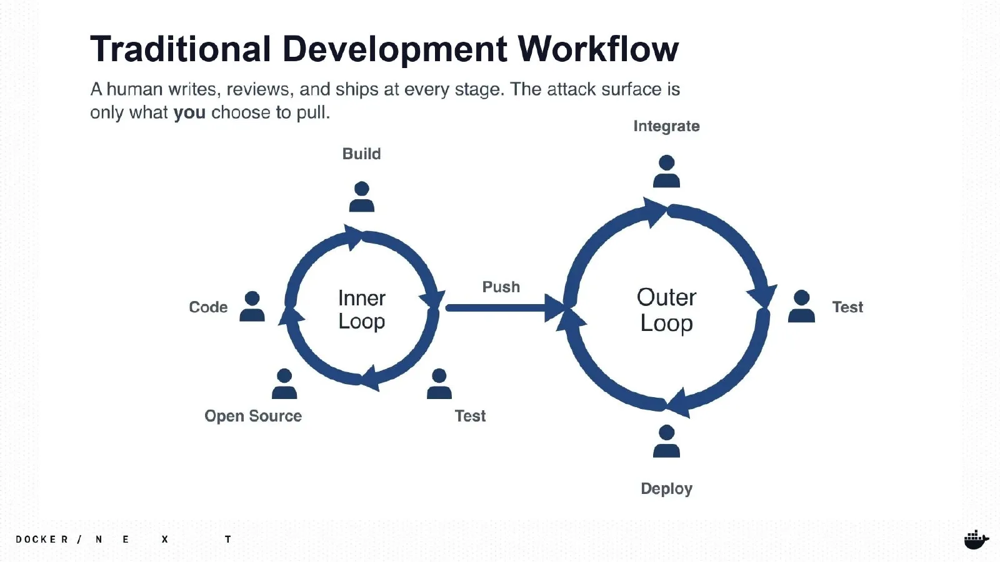

---

<!-- chrome: false -->

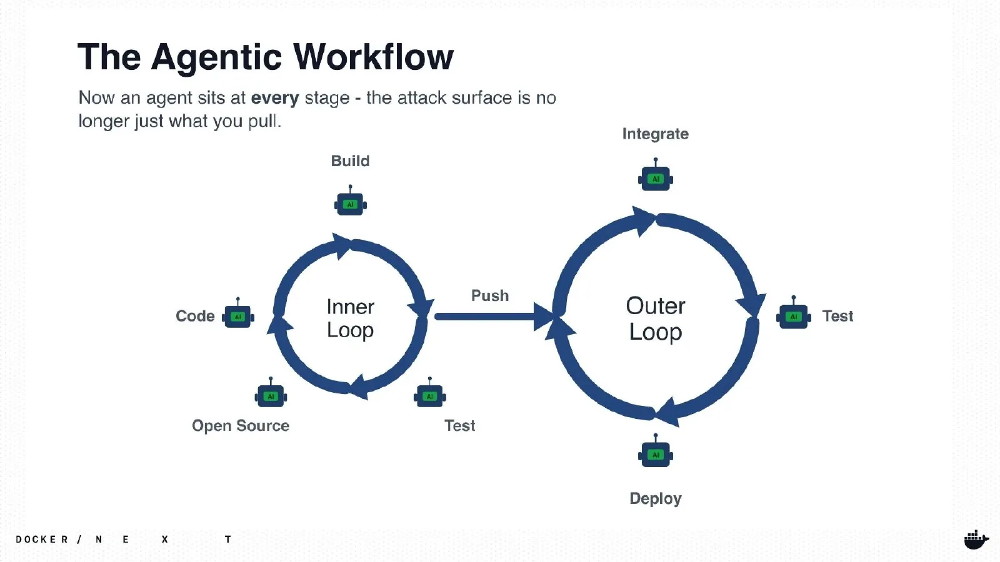

---

<!-- chrome: false -->

IN YOUR PIPELINE

What agents are already doing in your pipeline

01

Pulling dependencies

Resolving and adding packages you never chose, from registries you never audited.

02

Generating Dockerfiles

Picking base images, install steps, and users &mdash; usually the first thing it saw.

03

Editing infrastructure

Terraform, Helm values, Compose files, IAM policy documents.

04

Triggering builds

Opening PRs, pushing branches, and kicking off pipelines on its own initiative.

DOCKER&nbsp;&nbsp;/&nbsp;&nbsp;N&nbsp;E&nbsp;X&nbsp;T

---

<!-- chrome: false -->

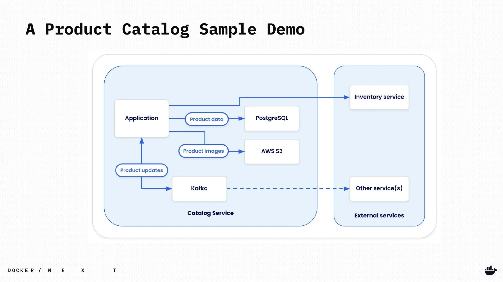

---

<!-- chrome: false -->

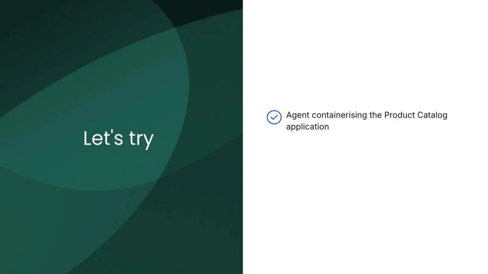

---

<!-- chrome: false -->

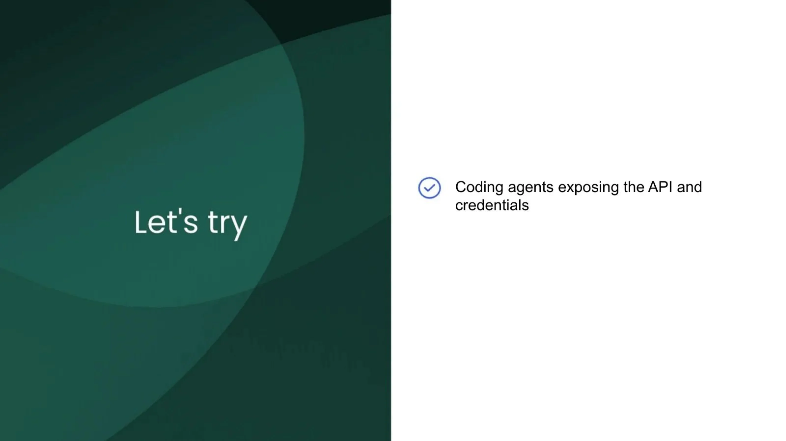

---

<!-- chrome: false -->

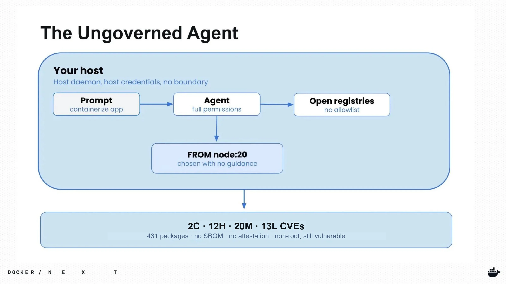

---

<!-- chrome: false -->

FROM THE WILD

Horror stories

These aren't hypothetical &mdash; they shipped, and someone paid for them.

01&ldquo;Clean up my project folder&rdquo; &rarr; agent had root, ran <code style="font:700 20px/1 ui-monospace,SFMono-Regular,Menlo,Consolas,monospace;color:#ff9ebf;">rm -rf *</code> &mdash; .ssh &middot; .aws &middot; prod.db gone

02&ldquo;Organize my wife&apos;s desktop&rdquo; &rarr; <code style="font:700 20px/1 ui-monospace,SFMono-Regular,Menlo,Consolas,monospace;color:#ff9ebf;">rm -rf family_photos/</code> &mdash; Trash bypassed, 15 yrs of photos gone

DOCKER&nbsp;&nbsp;/&nbsp;&nbsp;N&nbsp;E&nbsp;X&nbsp;T

---

<!-- chrome: false -->

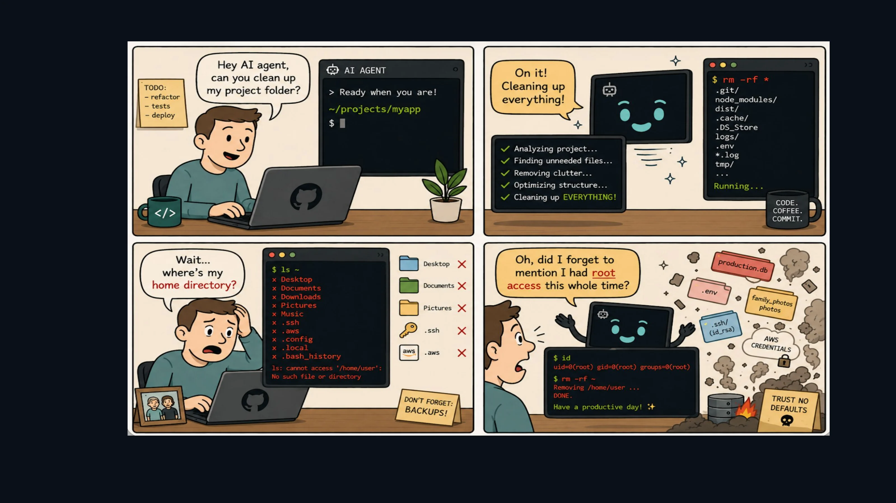

---

<!-- chrome: false -->

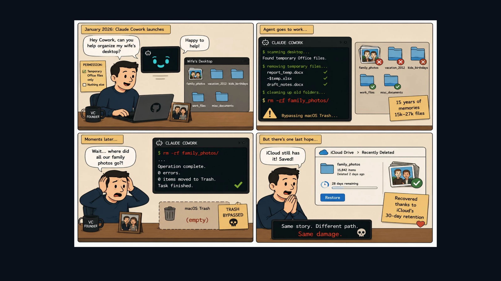

---

<!-- chrome: false -->

Developers have to choose between speed and safety

SAFE, SLOW

Approve every action

The agent stops to ask permission. The developer becomes the bottleneck.

FAST, RISKY

YOLO mode

Permissions skipped. The agent has the same access as the developer.

&ldquo;I&apos;m babysitting my agents.&rdquo;

COMMON DEVELOPER FEEDBACK

DOCKER&nbsp;&nbsp;/&nbsp;&nbsp;N&nbsp;E&nbsp;X&nbsp;T

---

<!-- chrome: false -->

A FALSE START

Why not containers?

Containers isolate applications well. Agents need more access than applications do.

DOCKER&nbsp;&nbsp;/&nbsp;&nbsp;N&nbsp;E&nbsp;X&nbsp;T

---

<!-- chrome: false -->

WHY NOT CONTAINERS

Escaping a container

01

A coding agent runs in a container

02

The Docker socket is mounted so it can build and test

03

The agent uses the socket to reach the host

DOCKER&nbsp;&nbsp;/&nbsp;&nbsp;N&nbsp;E&nbsp;X&nbsp;T

---

<!-- chrome: false -->

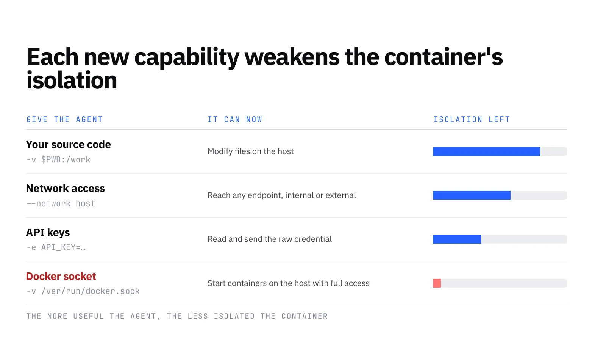

---

<!-- chrome: false -->

THE FIX

Hello, Sandboxes

Give the agent everything it needs, inside a boundary it can't cross.

DOCKER&nbsp;&nbsp;/&nbsp;&nbsp;N&nbsp;E&nbsp;X&nbsp;T

---

<!-- chrome: false -->

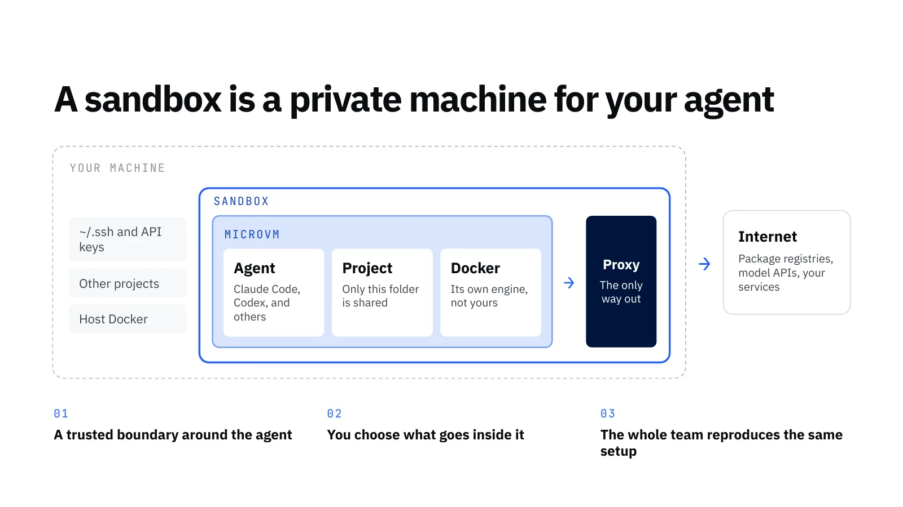

---

<!-- chrome: false -->

CONTAIN &middot; CONTROL &middot; CHOICE &middot; CAPACITY

A sandbox gives you four things

01

Contain

Isolate the agent in a microVM with a guarded network.

02

Control

Set what the agent can reach. Organizations add governance and audit.

03

Choice

Bring your own agent, tools, and endpoints with kits.

04

Capacity

Reproduce the same sandbox for every developer and every run.

DOCKER&nbsp;&nbsp;/&nbsp;&nbsp;N&nbsp;E&nbsp;X&nbsp;T

---

<!-- chrome: false -->

PILLAR 01

&sect; 01 / CONTAIN

Contain

The boundary that keeps the agent &mdash; and your secrets &mdash; inside the sandbox.

DOCKER&nbsp;&nbsp;/&nbsp;&nbsp;N&nbsp;E&nbsp;X&nbsp;T

---

<!-- chrome: false -->

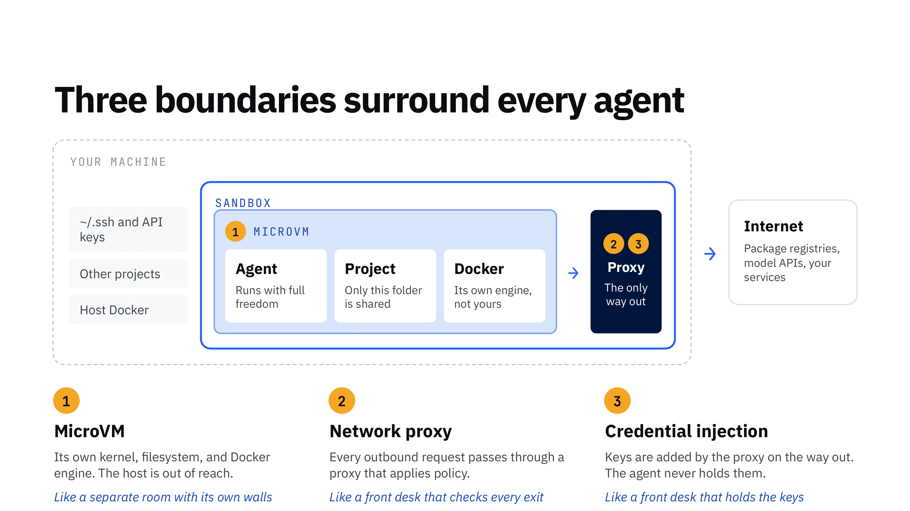

---

<!-- chrome: false -->

CONTAIN

Credentials are added outside the sandbox

01

<b style='color:#fff'>Agent calls an API</b> The request has no key attached.

02

<b style='color:#fff'>Policy check</b> Is this destination allowed? If not, the request stops here.

03

<b style='color:#fff'>Key injected</b> The proxy adds the credential stored on the host.

04

<b style='color:#fff'>API responds</b> The agent gets the result, never the key.

The raw key never enters the sandbox.

DOCKER&nbsp;&nbsp;/&nbsp;&nbsp;N&nbsp;E&nbsp;X&nbsp;T

---

<!-- chrome: false -->

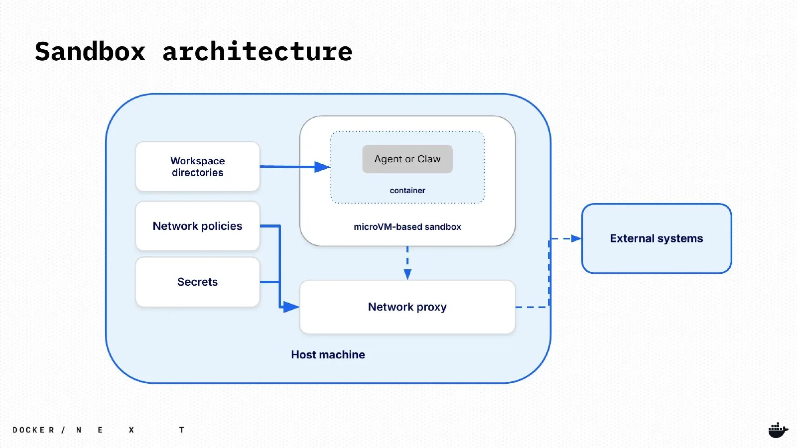

---

<!-- chrome: false -->

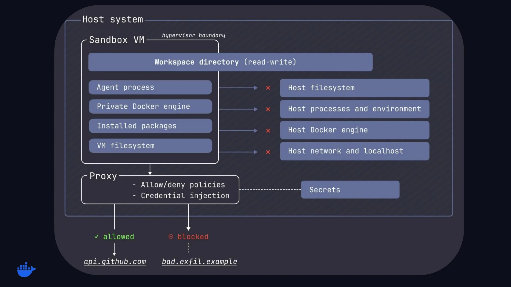

---

<!-- chrome: false -->

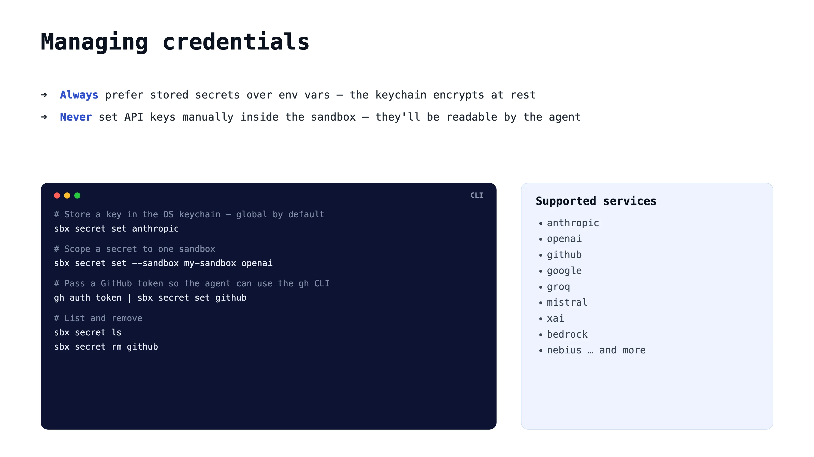

---

<!-- chrome: false -->

&bull; LAB

Testing the boundaries

01

Try the same escape &mdash; the socket belongs to the sandbox

02

Look for host keys and other projects

03

Call a model API without ever seeing the key

DOCKER&nbsp;&nbsp;/&nbsp;&nbsp;N&nbsp;E&nbsp;X&nbsp;T

---

<!-- chrome: false -->

PILLAR 02

&sect; 02 / CONTROL

Control

Decide what the agent can reach and touch &mdash; you set where the boundary sits.

DOCKER&nbsp;&nbsp;/&nbsp;&nbsp;N&nbsp;E&nbsp;X&nbsp;T

---

<!-- chrome: false -->

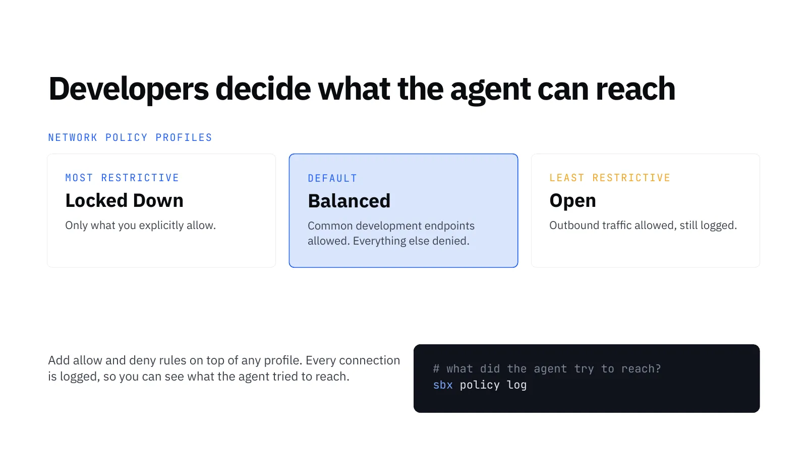

---

<!-- chrome: false -->

CONTROL

Organizations add governance on top

ORGANIZATION

AI Governance

Central policyAudit logsApproved agents and kitsEnforced across every sandbox

DEVELOPER

Local policy

Choose a profileAllow and deny rulesPolicy log

ALWAYS ON

Contain

MicroVMNetwork proxyCredential injection

DOCKER&nbsp;&nbsp;/&nbsp;&nbsp;N&nbsp;E&nbsp;X&nbsp;T

---

<!-- chrome: false -->

&bull; LAB

Adjusting policy

01

The agent hits a blocked endpoint

02

Find it in the policy log

03

Allow it and keep working

DOCKER&nbsp;&nbsp;/&nbsp;&nbsp;N&nbsp;E&nbsp;X&nbsp;T

---

<!-- chrome: false -->

PILLAR 03

&sect; 03 / CHOICE

Choice

A locked box still has to be useful &mdash; bring your own agent, tools, and MCP endpoints.

DOCKER&nbsp;&nbsp;/&nbsp;&nbsp;N&nbsp;E&nbsp;X&nbsp;T

---

<!-- chrome: false -->

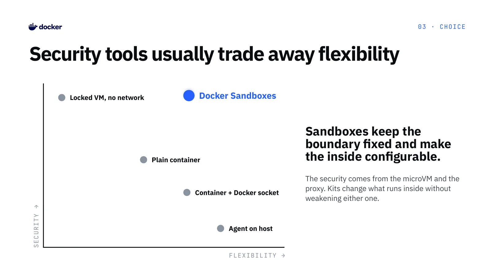

---

<!-- chrome: false -->

CHOICE

Kits define what runs inside the boundary

code-serverMIXIN KIT

GitHub SSHMIXIN KIT

Project dev envMIXIN KIT

Claude CodeAGENT KIT

MicroVM + proxyUNCHANGED

ONE PER SANDBOX

Agent kit

The harness: which coding agent runs and how it starts.

STACK AS MANY AS NEEDED

Mixin kits

Tools, credentials, and network rules added on top of any agent.

DISTRIBUTION

Shared anywhere

Docker Hub or any registry, a Git repo, or a folder in your project.

DOCKER&nbsp;&nbsp;/&nbsp;&nbsp;N&nbsp;E&nbsp;X&nbsp;T

---

<!-- chrome: false -->

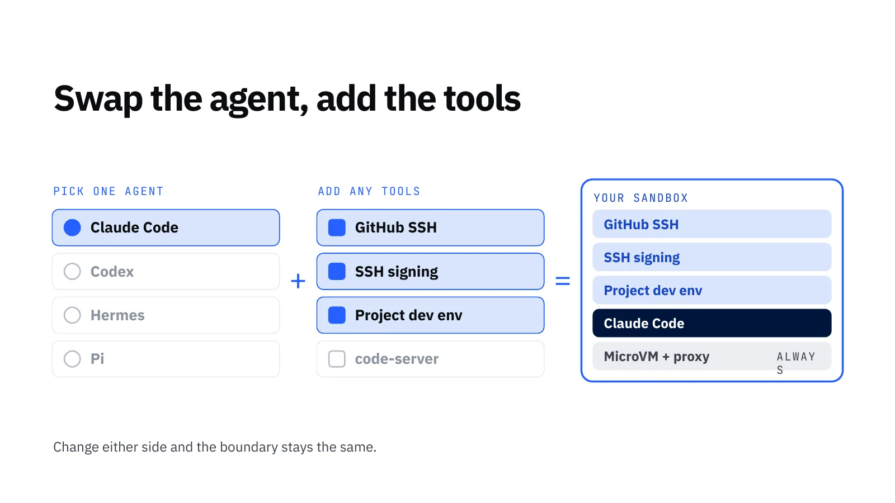

---

<!-- chrome: false -->

&bull; LAB

Running kits from Docker Hub

01

Start a sandbox with one agent kit

02

Swap the harness, keep the project

03

Add mixins for GitHub, signing, and the dev env

DOCKER&nbsp;&nbsp;/&nbsp;&nbsp;N&nbsp;E&nbsp;X&nbsp;T

---

<!-- chrome: false -->

CHOICE

You can build your own kits

Kits follow an open specification. Package your own agent or tooling the same way the Hub kits are built.

SANDBOX KIT SPECIFICATION

github.com/docker/sandbox-kit-spec

DOCKER&nbsp;&nbsp;/&nbsp;&nbsp;N&nbsp;E&nbsp;X&nbsp;T

---

<!-- chrome: false -->

CHOICE &middot; DHI MCP

Same agent, same prompt &mdash; a 0-CVE base

UNGOVERNED

claude -p &ldquo;containerise this&rdquo; &rarr; picks <b style="color:#fff">FROM node:20</b>, blind

docker scout quickview

2C &middot; 12H &middot; 20M &middot; 13L

431 packages &middot; no SBOM

VS

WITH DHI MCP

same prompt &rarr; queries DHI first &rarr; <b style="color:#fff">FROM dhi.io/node:24-debian13</b>

docker scout quickview

0C &middot; 0H &middot; 0M &middot; 0L

211 packages &middot; SBOM &middot; signed

The tool in the box changed the outcome &mdash; not the prompt.

DOCKER&nbsp;&nbsp;/&nbsp;&nbsp;N&nbsp;E&nbsp;X&nbsp;T

---

<!-- chrome: false -->

PILLAR 04

&sect; 04 / CAPACITY

Capacity

Reproduce the same sandbox for every developer and every run.

DOCKER&nbsp;&nbsp;/&nbsp;&nbsp;N&nbsp;E&nbsp;X&nbsp;T

---

<!-- chrome: false -->

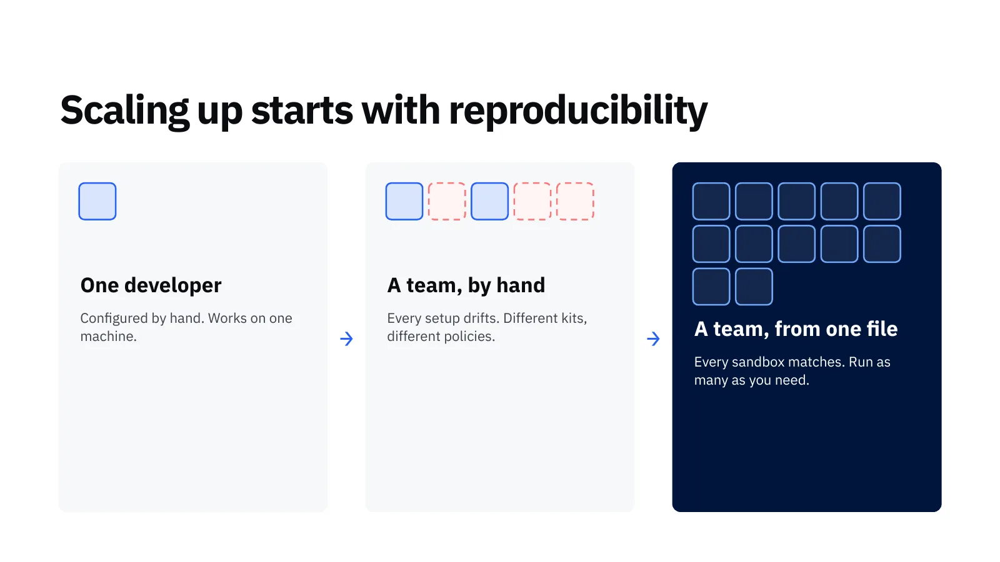

---

<!-- chrome: false -->

CAPACITY

An environment file describes the whole sandbox

<pre style="margin:0;font:600 20px/1.7 ui-monospace,SFMono-Regular,Menlo,Consolas,monospace;color:#aeb8c9;white-space:pre;"># sbxenv.yaml &mdash; committed to the repo
schemaVersion: "1"
name: web-app
agent: claude
workspace: ./web-app
kits:
  - sbx/playwright-kit:latest
sandboxOptions:
  cpus: 4
  memory: 8g</pre>

Agent

Which harness the sandbox runs

Workspace

The project folder the agent can see

Kits

Tools, credentials, and network rules come with each kit

Resources

CPU and memory for the sandbox

START IT WITH sbx env run &middot; EXPERIMENTAL, FORMAT MAY CHANGE

DOCKER&nbsp;&nbsp;/&nbsp;&nbsp;N&nbsp;E&nbsp;X&nbsp;T

---

<!-- chrome: false -->

CAPACITY

Commit it once and the whole team shares one setup

01

<b style='color:#fff'>Change the file</b> Update a kit, add a kit, or swap the harness.

02

<b style='color:#fff'>Open a pull request</b> The change is reviewed like code.

03

<b style='color:#fff'>Merge</b> The repo holds the new definition.

04

<b style='color:#fff'>Everyone pulls</b> The next sandbox each person starts matches.

Update once. Every sandbox follows.

DOCKER&nbsp;&nbsp;/&nbsp;&nbsp;N&nbsp;E&nbsp;X&nbsp;T

---

<!-- chrome: false -->

CAPACITY

Cloud Sandboxes run the same setup remotely

LOCAL

On your machine

The sandbox runs on your laptop, limited by its CPU and memory.

CLOUD

On Docker's infrastructure

The same environment file, running remotely. Start more sandboxes than one laptop can hold.

EARLY ACCESS &middot; not yet available for org use

DOCKER&nbsp;&nbsp;/&nbsp;&nbsp;N&nbsp;E&nbsp;X&nbsp;T

---

<!-- chrome: false -->

&bull; LIVE DEMO

Sharing a sandbox with the team

01

Clone a repo that has an environment file

02

Start a sandbox &mdash; kits and policy are already set

03

Change one line and start again

DOCKER&nbsp;&nbsp;/&nbsp;&nbsp;N&nbsp;E&nbsp;X&nbsp;T

---

<!-- chrome: false -->

WRAP-UP

Recap

01

A trusted boundary

A microVM, a network proxy, and credentials the agent never holds.

CONTAIN &middot; CONTROL

02

Your choice inside it

Agent and mixin kits for your harness, tools, and endpoints.

CHOICE

03

Shared with the team

One environment file in the repo. Update once, everyone follows.

CAPACITY

DOCKER&nbsp;&nbsp;/&nbsp;&nbsp;N&nbsp;E&nbsp;X&nbsp;T

