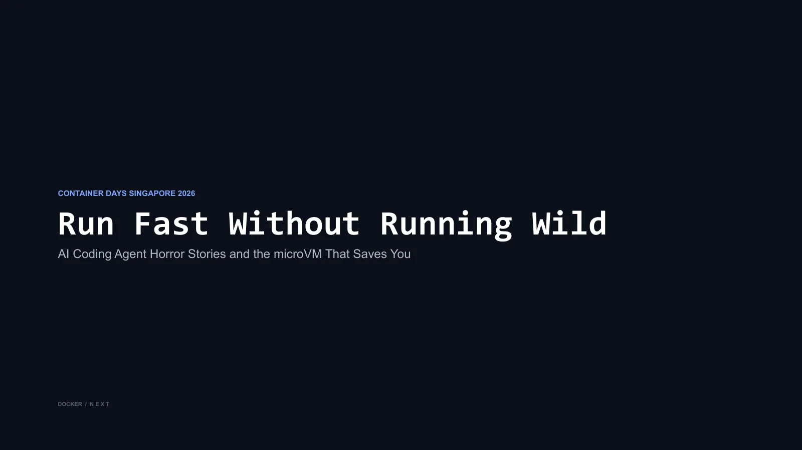
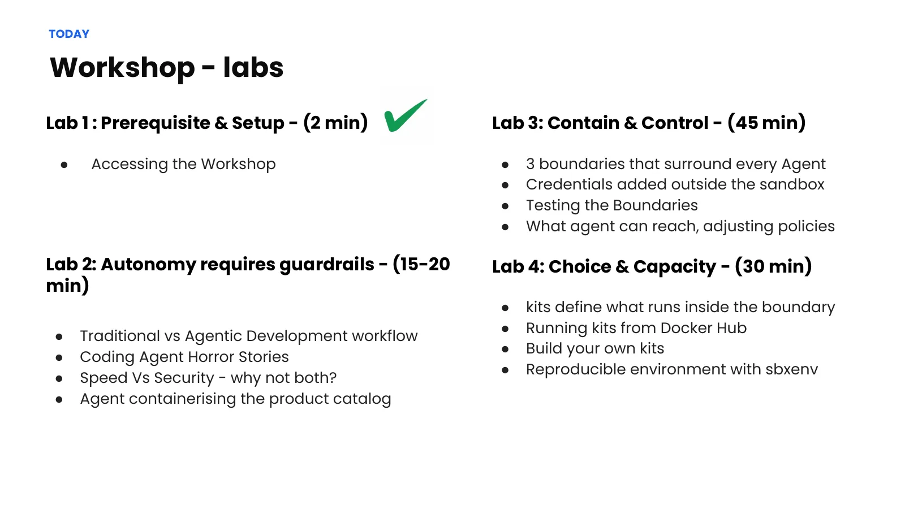
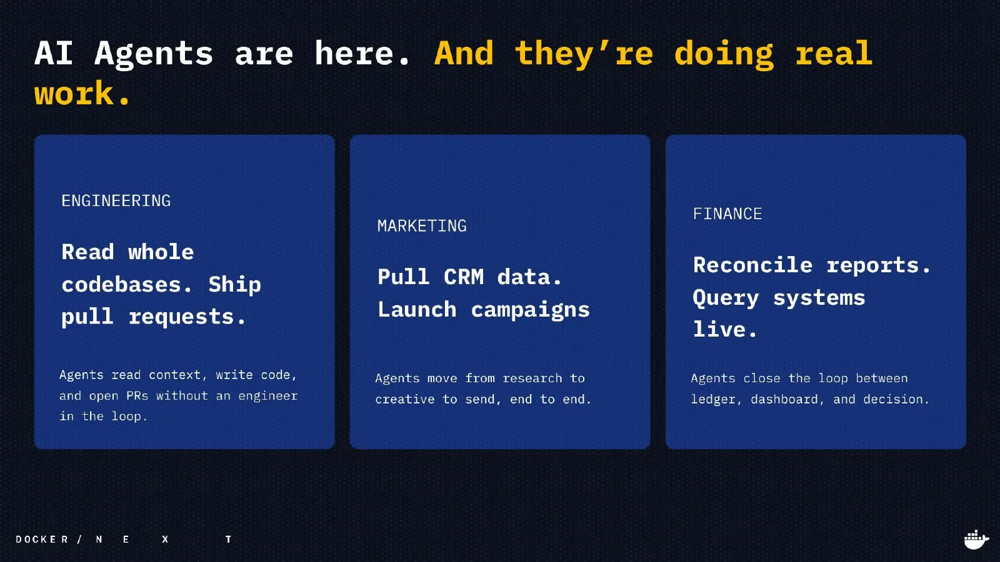
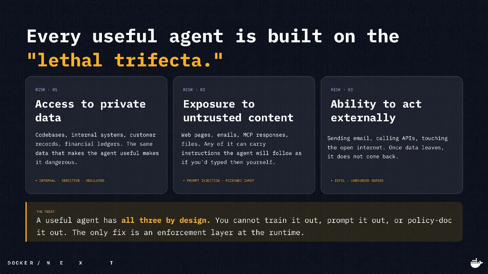
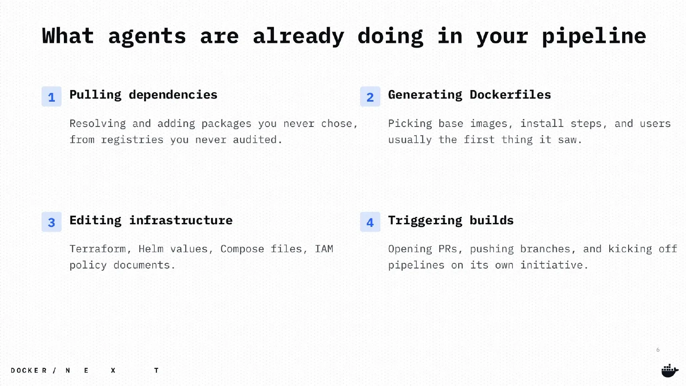
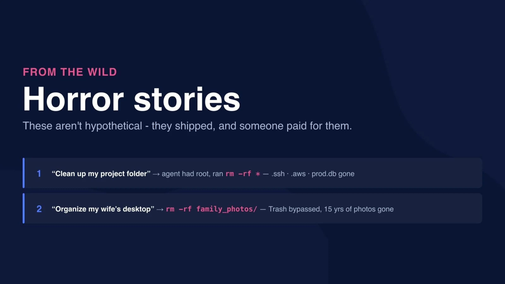
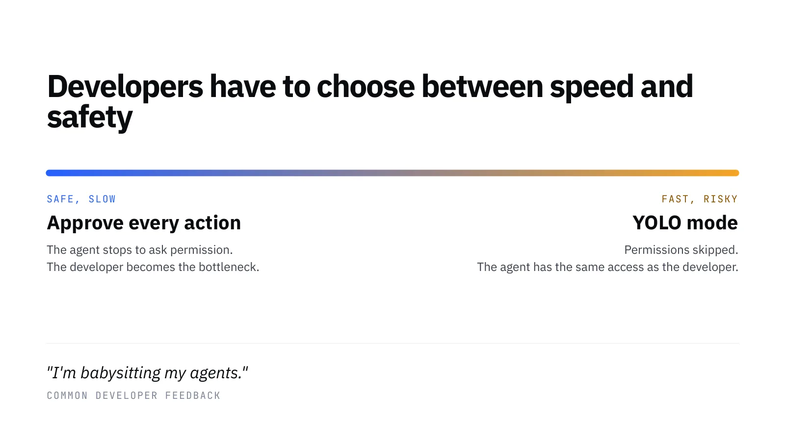
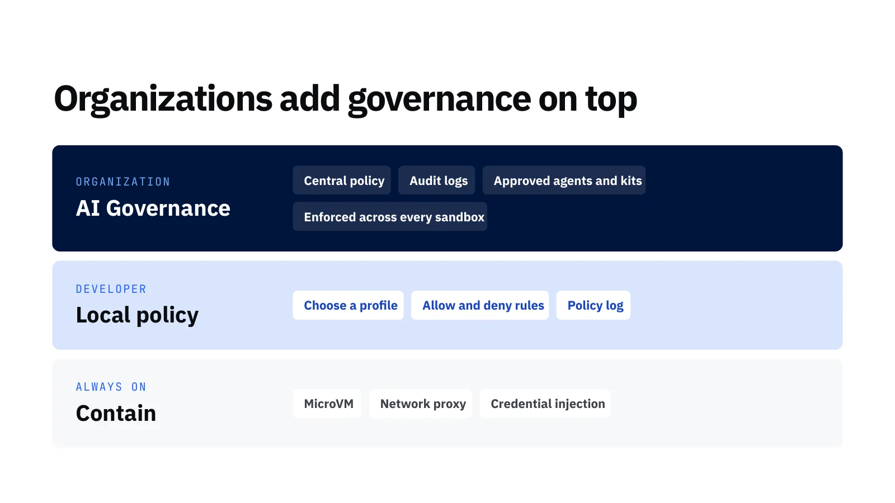
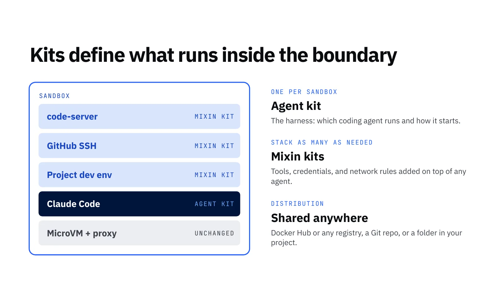
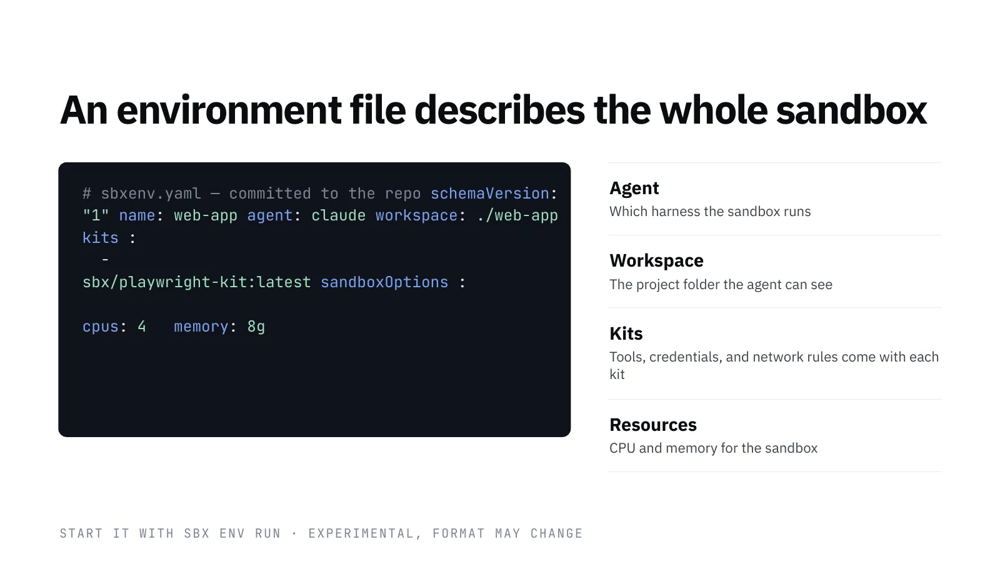

<!-- chrome: false -->

---

<!-- chrome: false -->

---

<!-- chrome: false -->

---

<!-- chrome: false -->

LAB 1 &middot; SETUP

Access the Workshop

containerdays.dockerworkshop.com &mdash; runs in your browser, nothing to install.

DOCKER&nbsp;&nbsp;/&nbsp;&nbsp;N&nbsp;E&nbsp;X&nbsp;T

---

<!-- chrome: false -->

---

<!-- chrome: false -->

---

<!-- chrome: false -->

---

<!-- chrome: false -->

---

<!-- chrome: false -->

---

<!-- chrome: false -->

---

<!-- chrome: false -->

---

<!-- chrome: false -->

---

<!-- chrome: false -->

---

<!-- chrome: false -->

---

<!-- chrome: false -->

---

<!-- chrome: false -->

---

<!-- chrome: false -->

---

<!-- chrome: false -->

---

<!-- chrome: false -->

A FALSE START

Why not containers?

Containers isolate applications well. Agents need more access than applications do.

DOCKER&nbsp;&nbsp;/&nbsp;&nbsp;N&nbsp;E&nbsp;X&nbsp;T

---

<!-- chrome: false -->

WHY NOT CONTAINERS

Escaping a container

01

A coding agent runs in a container

02

The Docker socket is mounted so it can build and test

03

The agent uses the socket to reach the host

DOCKER&nbsp;&nbsp;/&nbsp;&nbsp;N&nbsp;E&nbsp;X&nbsp;T

---

<!-- chrome: false -->

---

<!-- chrome: false -->

THE FIX

Hello, Sandboxes

Give the agent everything it needs, inside a boundary it can't cross.

DOCKER&nbsp;&nbsp;/&nbsp;&nbsp;N&nbsp;E&nbsp;X&nbsp;T

---

<!-- chrome: false -->

---

<!-- chrome: false -->

CONTAIN &middot; CONTROL &middot; CHOICE &middot; CAPACITY

A sandbox gives you four things

01

Contain

Isolate the agent in a microVM with a guarded network.

02

Control

Set what the agent can reach. Organizations add governance and audit.

03

Choice

Bring your own agent, tools, and endpoints with kits.

04

Capacity

Reproduce the same sandbox for every developer and every run.

DOCKER&nbsp;&nbsp;/&nbsp;&nbsp;N&nbsp;E&nbsp;X&nbsp;T

---

<!-- chrome: false -->

PILLAR 01

&sect; 01 / CONTAIN

Contain

The boundary that keeps the agent &mdash; and your secrets &mdash; inside the sandbox.

DOCKER&nbsp;&nbsp;/&nbsp;&nbsp;N&nbsp;E&nbsp;X&nbsp;T

---

<!-- chrome: false -->

---

<!-- chrome: false -->

CONTAIN

Credentials are added outside the sandbox

01

<b style='color:#fff'>Agent calls an API</b> The request has no key attached.

02

<b style='color:#fff'>Policy check</b> Is this destination allowed? If not, the request stops here.

03

<b style='color:#fff'>Key injected</b> The proxy adds the credential stored on the host.

04

<b style='color:#fff'>API responds</b> The agent gets the result, never the key.

The raw key never enters the sandbox.

DOCKER&nbsp;&nbsp;/&nbsp;&nbsp;N&nbsp;E&nbsp;X&nbsp;T

---

<!-- chrome: false -->

---

<!-- chrome: false -->

---

<!-- chrome: false -->

---

<!-- chrome: false -->

&bull; LAB

Testing the boundaries

01

Try the same escape &mdash; the socket belongs to the sandbox

02

Look for host keys and other projects

03

Call a model API without ever seeing the key

DOCKER&nbsp;&nbsp;/&nbsp;&nbsp;N&nbsp;E&nbsp;X&nbsp;T

---

<!-- chrome: false -->

PILLAR 02

&sect; 02 / CONTROL

Control

Decide what the agent can reach and touch &mdash; you set where the boundary sits.

DOCKER&nbsp;&nbsp;/&nbsp;&nbsp;N&nbsp;E&nbsp;X&nbsp;T

---

<!-- chrome: false -->

---

<!-- chrome: false -->

---

<!-- chrome: false -->

&bull; LAB

Adjusting policy

01

The agent hits a blocked endpoint

02

Find it in the policy log

03

Allow it and keep working

DOCKER&nbsp;&nbsp;/&nbsp;&nbsp;N&nbsp;E&nbsp;X&nbsp;T

---

<!-- chrome: false -->

PILLAR 03

&sect; 03 / CHOICE

Choice

A locked box still has to be useful &mdash; bring your own agent, tools, and MCP endpoints.

DOCKER&nbsp;&nbsp;/&nbsp;&nbsp;N&nbsp;E&nbsp;X&nbsp;T

---

<!-- chrome: false -->

---

<!-- chrome: false -->

---

<!-- chrome: false -->

---

<!-- chrome: false -->

&bull; LAB

Running kits from Docker Hub

01

Start a sandbox with one agent kit

02

Swap the harness, keep the project

03

Add mixins for GitHub, signing, and the dev env

DOCKER&nbsp;&nbsp;/&nbsp;&nbsp;N&nbsp;E&nbsp;X&nbsp;T

---

<!-- chrome: false -->

CHOICE

You can build your own kits

Kits follow an open specification. Package your own agent or tooling the same way the Hub kits are built.

SANDBOX KIT SPECIFICATION

github.com/docker/sandbox-kit-spec

DOCKER&nbsp;&nbsp;/&nbsp;&nbsp;N&nbsp;E&nbsp;X&nbsp;T

---

<!-- chrome: false -->

PILLAR 04

&sect; 04 / CAPACITY

Capacity

Reproduce the same sandbox for every developer and every run.

DOCKER&nbsp;&nbsp;/&nbsp;&nbsp;N&nbsp;E&nbsp;X&nbsp;T

---

<!-- chrome: false -->

---

<!-- chrome: false -->

---

<!-- chrome: false -->

CAPACITY

Commit it once and the whole team shares one setup

01

<b style='color:#fff'>Change the file</b> Update a kit, add a kit, or swap the harness.

02

<b style='color:#fff'>Open a pull request</b> The change is reviewed like code.

03

<b style='color:#fff'>Merge</b> The repo holds the new definition.

04

<b style='color:#fff'>Everyone pulls</b> The next sandbox each person starts matches.

Update once. Every sandbox follows.

DOCKER&nbsp;&nbsp;/&nbsp;&nbsp;N&nbsp;E&nbsp;X&nbsp;T

---

<!-- chrome: false -->

CAPACITY

Cloud Sandboxes run the same setup remotely

LOCAL

On your machine

The sandbox runs on your laptop, limited by its CPU and memory.

CLOUD

On Docker's infrastructure

The same environment file, running remotely. Start more sandboxes than one laptop can hold.

EARLY ACCESS &middot; not yet available for org use

DOCKER&nbsp;&nbsp;/&nbsp;&nbsp;N&nbsp;E&nbsp;X&nbsp;T

---

<!-- chrome: false -->

&bull; LIVE DEMO

Sharing a sandbox with the team

01

Clone a repo that has an environment file

02

Start a sandbox &mdash; kits and policy are already set

03

Change one line and start again

DOCKER&nbsp;&nbsp;/&nbsp;&nbsp;N&nbsp;E&nbsp;X&nbsp;T

---

<!-- chrome: false -->

WRAP-UP

Recap

01

A trusted boundary

A microVM, a network proxy, and credentials the agent never holds.

CONTAIN &middot; CONTROL

02

Your choice inside it

Agent and mixin kits for your harness, tools, and endpoints.

CHOICE

03

Shared with the team

One environment file in the repo. Update once, everyone follows.

CAPACITY

DOCKER&nbsp;&nbsp;/&nbsp;&nbsp;N&nbsp;E&nbsp;X&nbsp;T

